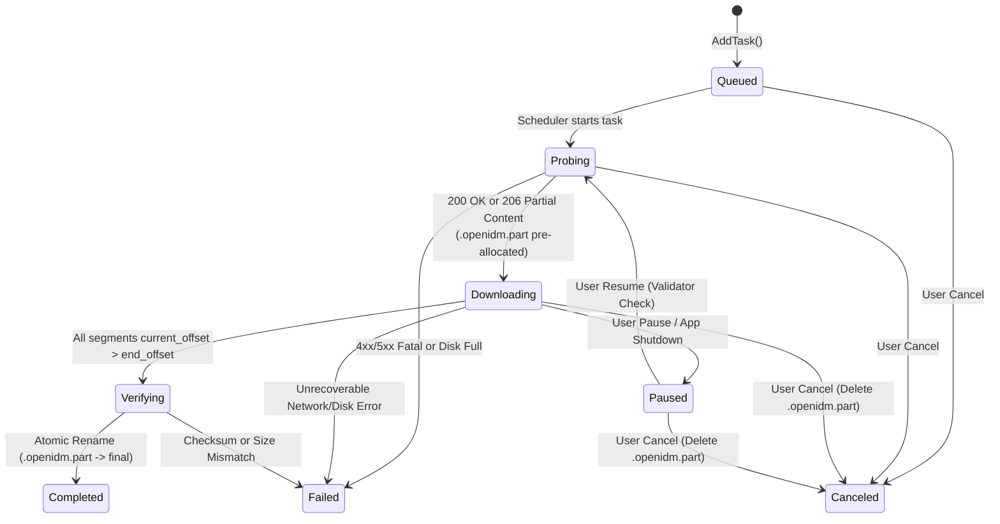

# Ordinary File Download Engine Design

**Document Status:** Proposed Subsystem Specification  
**Last Reviewed:** 2026-10-16  
**Scope:** Architecture, C++20 interfaces, dynamic connection spawning, work-stealing byte-range splitting, HTTP range detection, disk I/O, and crash-safe recovery for `src/engine_http/`.  
**Related Documents:** [SYSTEM_ARCHITECTURE.md](SYSTEM_ARCHITECTURE.md), [DATA_MODEL_AND_STORAGE.md](DATA_MODEL_AND_STORAGE.md), [ERROR_HANDLING_AND_RECOVERY.md](ERROR_HANDLING_AND_RECOVERY.md), [adr/0005-download-engine-integration.md](adr/0005-download-engine-integration.md)

---

## 1. Design Objectives & Upstream Inspiration

The Ordinary File Download Engine (`openidm::engine::WinHttpDownloadEngine`) handles all direct HTTP/1.1 and HTTP/2 single-file transfers (`.zip`, `.iso`, `.exe`, `.pdf`, and progressive `.mp4`/`.webm` video files). It adapts the three core algorithmic innovations of [Brisk Download Manager](https://github.com/BrisklyDev/brisk) into native C++20 on top of the Windows `WinHTTP` asynchronous API and Windows I/O Completion Ports (IOCP):
1. **Dynamic Connection Spawning (`FR-003`):** Starts every download with a single connection (`Worker 0`) and spawns additional workers (`1 .. N-1`) only after byte-range capability is confirmed and active throughput justifies concurrency.
2. **Dynamic Connection Reuse / Work-Stealing (`FR-003`):** When any worker finishes its assigned `[start_offset, end_offset]` range, it immediately steals the back half of the largest remaining active segment (`>= 2 MiB` left), keeping all connections busy until the final megabyte.
3. **Automatic Stall Reset (`FR-004`):** Monitors per-worker sliding-window throughput and resets individual hung connections at their exact persisted `current_offset` without failing the task.

---

## 2. Task & Segment State Machine



---

## 3. HTTP Range Detection & Non-Range Server Fallback (`FR-001`, `FR-002`)

Servers frequently misreport or inconsistently implement HTTP byte ranges. `WinHttpDownloadEngine` executes a strict 2-step probe protocol before spawning workers:

### 3.1 Step 1 — Initial `GET` with `Range: bytes=0-`
Instead of relying solely on `HEAD` (which many signed CDNs such as AWS S3 pre-signed GET URLs reject with `403 Forbidden` because the signature covers only the `GET` method), `Worker 0` sends an initial **`GET` request with `Range: bytes=0-`** and custom headers (`Referer`, `User-Agent`, `Cookie`):
1. **Case A — Server responds `206 Partial Content` with valid `Content-Range: bytes 0-<last>/<total>`:**
   - `range_supported = true`, `total_bytes = <total>`, `pause_supported = true`.
   - Record `ETag` (if strong, i.e., not prefixed with `W/`) and `Last-Modified` validators.
   - `Worker 0` immediately continues streaming body bytes from this already-open connection while the `SegmentScheduler` evaluates spawning `Worker 1 .. K-1`.
2. **Case B — Server responds `200 OK` with `Content-Length: <total>`:**
   - Check if `Accept-Ranges: bytes` header is explicitly present.
   - If `Accept-Ranges: bytes` is absent or `none`, set `range_supported = false`, `pause_supported = false`, and continue downloading the entire file on `Worker 0` alone without spawning additional connections (`FR-002`).
   - If `Accept-Ranges: bytes` is present (some servers ignore `Range: bytes=0-` with open-ended range), `Worker 1` tests `Range: bytes=<mid>-<total-1>`. Only if `Worker 1` receives `206 Partial Content` is `range_supported` upgraded to `true`.
3. **Case C — Server responds `200 OK` with `Transfer-Encoding: chunked` (No `Content-Length`):**
   - `range_supported = false`, `total_bytes = 0 (Unknown)`, `pause_supported = false`.
   - Download proceeds on `Worker 0` alone, appending sequentially to `<filename>.openidm.part`.

### 3.2 Guard Against Misbehaving Servers During Multi-Segment Transfers (`RISK-006`)
Every secondary worker (`Worker 1 .. N-1`) requests `Range: bytes=<start>-<end>`. Upon receiving headers (`WINHTTP_CALLBACK_STATUS_HEADERS_AVAILABLE`):
- If HTTP status is **not `206 Partial Content`** (for example, the server ignores the `Range` header and returns `200 OK` from byte 0), the worker **immediately closes the request handle without writing a single byte to disk**, disables further connection spawning for that task, and logs `WARN_SERVER_IGNORED_RANGE`.
- Furthermore, the worker parses `Content-Range: bytes <resp_start>-<resp_end>/<resp_total>` and verifies `resp_start == requested_start` and `resp_total == task.total_bytes` before writing to disk.

---

## 4. Dynamic Connection Spawning & Work-Stealing Algorithm (`FR-003`)

### 4.1 Parameters & Thresholds
- `kDefaultMaxConnections = 8` (user configurable `1..32`).
- `kMinSegmentSize = 1048576` (`1 MiB` — never split a range if the resulting half would be smaller than `1 MiB`).
- `kSpawnIntervalMs = 500` (ramp-up check interval).

### 4.2 Dynamic Ramp-Up
1. At `t = 0`, `Worker 0` starts with range `[0, total_bytes - 1]`.
2. Every `500 ms` while `active_workers < max_connections`:
   - If `range_supported == true` and `Worker 0` (or the existing workers) has received bytes within the last `500 ms` and the largest remaining segment has `>= 2 * kMinSegmentSize` (`2 MiB`) remaining:
   - Spawn `1` new worker by splitting the largest active segment.
   - Progressive spawning prevents opening 8 simultaneous TLS handshakes for small (`< 2 MiB`) files or dead URLs.

### 4.3 Work-Stealing Byte-Range Split (`OnWorkerCompleted`)
When `Worker i` reaches `current_offset > end_offset`:
1. Acquire `m_scheduler_mutex` on the task's `SegmentScheduler`.
2. Scan all active segments `j` to find the segment with the maximum remaining bytes:
   $$\\text{remaining}_j = \\text{end\\_offset}_j - \\text{current\\_offset}_j + 1$$
3. If $\\max_j (\\text{remaining}_j) < 2 \\times \\text{kMinSegmentSize}$ (`2 MiB`), `Worker i` transitions to `Completed` and exits cleanly.
4. Otherwise, compute the split point aligned to a `4 KiB` (`4096`-byte) disk sector boundary:
   $$\\text{split\\_offset} = \\text{ align\\_4k }\\left(\\text{current\\_offset}_j + \\frac{\\text{remaining}_j}{2}\\right)$$
5. Update `Segment j`'s `end_offset = split_offset - 1` (atomic `std::atomic<uint64_t>` read by `Worker j` on every buffer write so `Worker j` stops automatically when `current_offset > end_offset`).
6. Assign `Worker i` the new segment `[split_offset, old_end_offset]` and persist both segment updates in a single SQLite batch transaction before issuing `WinHttpSendRequest`.

---

## 5. Disk Writes, Pre-Allocation, and File Integrity (`FR-026`)

1. **Shared File Handle with Overlapped Positional Writes:**
   - Once `total_bytes` is known, `WinHttpDownloadEngine` opens `<dest_dir>\\<filename>.openidm.part` using `CreateFileW` with `GENERIC_WRITE | GENERIC_READ`, `FILE_SHARE_READ`, and `FILE_FLAG_OVERLAPPED` (or positional `WriteFile` with explicit `OVERLAPPED.Offset` / `OffsetHigh`).
   - Pre-allocates the file size via `SetFileInformationByHandle(..., FileEndOfFileInfo, ...)` to immediately detect `ERROR_DISK_FULL` (`FR-001`) and prevent NTFS fragmentation.
2. **Per-Worker Double Buffering:**
   - Each worker maintains two `64 KiB` read buffers (`16 connections * 128 KiB = 2 MiB` total RAM per task). While `WinHttpReadData` fills Buffer A asynchronously, Buffer B is written at exact byte offset `current_offset` to `.openidm.part`.
3. **Final Verification & Atomic Rename:**
   - When all segments complete, verify that the sum of all completed segment lengths equals `total_bytes` and flush buffers via `FlushFileBuffers`.
   - If the user provided an expected checksum (`SHA-256` / `MD5`), stream `.openidm.part` through Windows CNG (`BCryptHashData`).
   - Atomically rename `<filename>.openidm.part` to `<filename>` via `SetFileInformationByHandle` (`FileRenameInfoEx`), applying the configured conflict policy (`Auto-Rename`, `Overwrite`, or `Prompt`).

---

## 6. C++20 Engine Interface (`src/engine_http/IFileDownloadEngine.hpp`)

```cpp
// SPDX-License-Identifier: GPL-3.0-or-later
#pragma once
#include <cstdint>
#include <functional>
#include <string>
#include <vector>
#include "common/result.hpp"

namespace openidm::engine {

struct SegmentState {
    uint32_t segment_id{};
    uint64_t start_offset{};
    uint64_t current_offset{};
    uint64_t end_offset{}; // Inclusive; UINT64_MAX if unknown length
    bool completed{false};
};

struct FileDownloadSpec {
    std::string task_id;
    std::string url;
    std::wstring part_file_path;
    std::vector<std::pair<std::string, std::string>> headers; // Referer, User-Agent, Cookie
    uint32_t max_connections{8};
    uint64_t speed_limit_bytes_per_sec{0}; // 0 = unlimited
    std::string expected_etag;
    std::string expected_last_modified;
    uint64_t expected_total_bytes{0};
    std::vector<SegmentState> resume_segments;
};

struct FileProgressEvent {
    std::string task_id;
    uint64_t downloaded_bytes{};
    uint64_t total_bytes{};
    uint64_t speed_bytes_per_sec{};
    bool range_supported{false};
    std::vector<SegmentState> segments;
};

class IFileDownloadEngine {
public:
    virtual ~IFileDownloadEngine() = default;

    using ProgressCallback = std::function<void(const FileProgressEvent&)>;
    using CompletionCallback = std::function<void(const std::string& task_id, Result<void, EngineError>)>;

    virtual Result<void, EngineError> StartTask(
        const FileDownloadSpec& spec,
        ProgressCallback on_progress,
        CompletionCallback on_complete) = 0;

    virtual Result<void, EngineError> PauseTask(const std::string& task_id) = 0;
    virtual Result<void, EngineError> CancelTask(const std::string& task_id) = 0;
    virtual void SetTaskSpeedLimit(const std::string& task_id, uint64_t bytes_per_sec) = 0;
};

} // namespace openidm::engine
```
