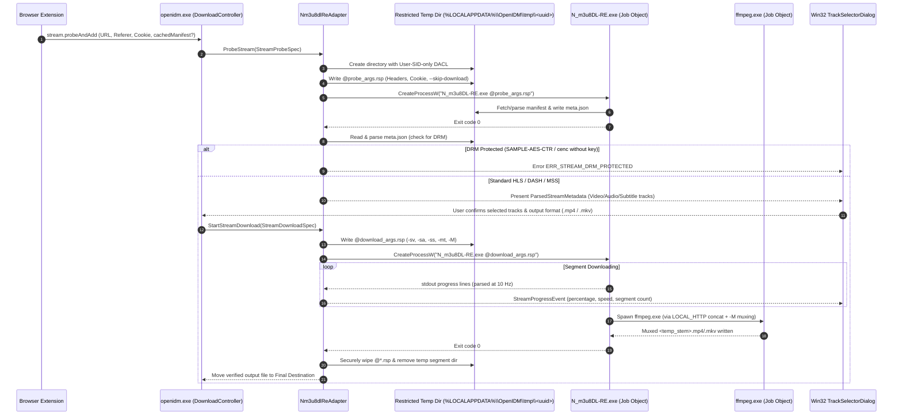

# Stream Download Pipeline Specification

**Document Status:** Proposed Subsystem Specification  
**Last Reviewed:** 2026-10-16  
**Scope:** End-to-end workflow for HLS (`.m3u8`), DASH (`.mpd`), and MSS (`.ism`) stream probing, track selection, concurrent segment downloading, decryption boundaries, and FFmpeg muxing via `src/engine_stream/`.  
**Related Documents:** [MEDIA_DETECTION.md](MEDIA_DETECTION.md), [UPSTREAM_PROJECT_ANALYSIS.md](UPSTREAM_PROJECT_ANALYSIS.md), [SECURITY_THREAT_MODEL.md](SECURITY_THREAT_MODEL.md), [adr/0005-download-engine-integration.md](adr/0005-download-engine-integration.md)

---

## 1. Pipeline Overview

When the user selects a streaming media candidate (`.m3u8`, `.mpd`, or `.ism`) from the browser overlay button or extension popup, OpenIDM executes a two-phase out-of-process workflow orchestrated by `openidm::engine::Nm3u8dlReAdapter` (`src/engine_stream/`):
1. **Phase 1 — Manifest Probe (`Probing` State):** Spawns `N_m3u8DL-RE.exe` with `--skip-download --write-meta-json` inside a Windows Job Object to parse the manifest and emit `<task_tmp>\\meta.json`.
2. **Phase 2 — Track Selection, Segment Download & Container Mux (`Downloading` -> `Muxing` -> `Completed`):** Displays the native Win32 Track Selection Dialog (`FR-019`), then spawns `N_m3u8DL-RE.exe` with the user's selected video/audio/subtitle filters (`-sv`, `-sa`, `-ss`), concurrent download flag (`-mt`), and automatic FFmpeg muxing (`-M`).

---

## 2. Stream Pipeline Sequence Diagram



---

## 3. Differentiating Stream Protocols & DRM Boundaries (`NFR-015`)

| Stream Type | Manifest Format | Segment Containers | Encryption / DRM Status | OpenIDM Support Policy |
| :--- | :--- | :--- | :--- | :--- |
| **Progressive HTTP Media** | None (Direct URL) | `.mp4`, `.webm`, `.mkv`, `.mp3` | Unencrypted (HTTPS transport) | **Supported:** Routed to in-process `WinHttpDownloadEngine` (not `N_m3u8DL-RE`). |
| **Unencrypted HLS (VOD & Live)** | `.m3u8` (RFC 8216) | `.ts` (MPEG-2 TS), `.m4s` / `.mp4` (CMAF fMP4), `.aac`, `.vtt` | `#EXT-X-KEY:METHOD=NONE` or no key tag | **Supported:** Full variant selection, concurrent segment download, and FFmpeg muxing. |
| **Standard HLS AES-128** | `.m3u8` | `.ts` or `.m4s` encrypted with AES-128-CBC | `#EXT-X-KEY:METHOD=AES-128,URI="https://..."` | **Supported (`FR-022`):** When the standard 16-byte key URI is accessible using the user's browser session cookies/headers (or user-provided key in Advanced Options), `N_m3u8DL-RE` decrypts segments in-memory using standard AES-128. |
| **Unencrypted MPEG-DASH** | `.mpd` (ISO/IEC 23009-1) | `_init.mp4` + `.m4s` segments | No `<ContentProtection>` element | **Supported:** Full `AdaptationSet`/`Representation` selection, multi-Period filtering, and FFmpeg muxing. |
| **DRM-Protected HLS / DASH (Widevine, PlayReady, FairPlay, CENC)** | `.m3u8` or `.mpd` | `.m4s` / `.ts` encrypted via `cenc`, `cbcs`, `SAMPLE-AES`, `SAMPLE-AES-CTR` | `<ContentProtection schemeIdUri="urn:uuid:edef8ba9-...">` (Widevine) or `9a04f079-...` (PlayReady) | **Strictly Unsupported (`NFR-015`):** OpenIDM will **never** bypass DRM, query CDM license servers for keys, or bundle `mp4decrypt`. Detected immediately during Layer 2 (`video.mediaKeys`) or Phase 1 (`meta.json` inspection) and rejected with `ERR_STREAM_DRM_PROTECTED`. |

---

## 4. Safe Argument Construction via Response Files (`FR-021`, `THREAT-002`)

Passing URLs, `Cookie` headers, `Referer` headers, or webpage titles directly on the Windows command line (`CreateProcessW` `lpCommandLine`) creates two severe vulnerabilities:
1. **Local Credential Leakage:** Any non-elevated process running under the same or another monitoring tool can read command-line strings via WMI (`Win32_Process.CommandLine`) or `NtQueryInformationProcess`.
2. **Argument Injection:** Quotes or `@` prefixes in untrusted strings can inject unintended `N_m3u8DL-RE` options.

### 4.1 Mandatory Response File (`@args.rsp`) Protocol
As verified in the [N_m3u8DL-RE v0.6.0 documentation](https://github.com/nilaoda/N_m3u8DL-RE/blob/main/README.en.md) (*"Existing `@args.txt` response files remain supported and their arguments have command-line precedence"*):
1. `Nm3u8dlReAdapter` creates `%LOCALAPPDATA%\\OpenIDM\\tmp\\<task_uuid>\\` with a Win32 Security Descriptor granting access **only** to the current user SID (`TokenUser`) and `SYSTEM`.
2. `Nm3u8dlReAdapter` writes all arguments—including `-H "Cookie: ..."`, `-H "Referer: ..."`, and the target URL—into `%LOCALAPPDATA%\\OpenIDM\\tmp\\<task_uuid>\\job.rsp` (UTF-8 without BOM).
3. Before writing any value into `job.rsp`, `Nm3u8dlReAdapter` enforces:
   - The input `<url>` must parse as a valid `http://` or `https://` URI (or an absolute path to the cached local manifest inside `<task_tmp>`) and must **never** start with `-` or `@`.
   - Every header string `<Key>: <Value>` has `\r`, `\n`, and `\0` stripped, and internal `"` characters escaped as `\"`.
   - `--save-name` is a strictly sanitized basename (`[A-Za-z0-9._ -]+`) validated by `PathSanitizer`.
4. `CreateProcessW` is invoked with:
   - `lpApplicationName`: Exact resolved path to `N_m3u8DL-RE.exe` (verified inside the app directory).
   - `lpCommandLine`: `"\"C:\\Program Files\\Flux\\tools\\win-x64\\N_m3u8DL-RE.exe\" --no-config --no-ansi-color --disable-update-check --vod-select-parts false --ui-language en-US @\"C:\\Users\\...\\AppData\\Local\\Flux\\tmp\\<task_uuid>\\job.rsp\""`
   - `dwCreationFlags`: `CREATE_NO_WINDOW | CREATE_SUSPENDED | CREATE_UNICODE_ENVIRONMENT` (assigned to the task's Job Object before `ResumeThread`).

### 4.2 Exact `job.rsp` Template for Phase 1 (Manifest Probe)
```text
"https://cdn.example.com/videos/12345/master.m3u8?token=xyz"
--skip-download
--write-meta-json
--tmp-dir "C:\Users\Alice\AppData\Local\OpenIDM\tmp\550e8400-e29b-41d4-a716-446655440000"
--no-log
--http-request-timeout 30
-H "User-Agent: Mozilla/5.0 (Windows NT 10.0; Win64; x64) AppleWebKit/537.36"
-H "Referer: https://watch.example.com/video/12345"
-H "Origin: https://watch.example.com"
-H "Cookie: session_id=secret_value"
```

### 4.3 Exact `job.rsp` Template for Phase 2 (Download & Mux)
```text
"https://cdn.example.com/videos/12345/master.m3u8?token=xyz"
--tmp-dir "C:\Users\Alice\AppData\Local\OpenIDM\tmp\550e8400-e29b-41d4-a716-446655440000"
--save-dir "C:\Users\Alice\Downloads\Video"
--save-name "Lecture_01_Introduction.openidm_mux"
--thread-count 10
--download-retry-count 7
--http-request-timeout 100
-mt
--check-segments-count true
--del-after-done true
--auto-subtitle-fix true
--sub-format SRT
--ffmpeg-binary-path "C:\Program Files\Flux\tools\win-x64\ffmpeg.exe"
--ffmpeg-concat-mode LOCAL_HTTP
-sv res="1920*":codecs="avc1":for=best
-sa lang="en":for=best
-ss lang="en":for=all
-M format=mp4:muxer=ffmpeg:bin_path="C\:\Program Files\Flux\tools\win-x64\ffmpeg.exe":keep=false
-H "User-Agent: Mozilla/5.0 (Windows NT 10.0; Win64; x64) AppleWebKit/537.36"
-H "Referer: https://watch.example.com/video/12345"
-H "Cookie: session_id=secret_value"
```
*(Note: As documented in the upstream `N_m3u8DL-RE` v0.6.0 manual, colons inside `-M bin_path=...` composite values must be escaped as `\:` on Windows paths, e.g., `C\:\Program Files\...`!)*

---

## 5. Progress Parsing, Resumption, and Cancellation

1. **Stdout Progress Parsing:**
   - With `--no-ansi-color --ui-language en-US`, `N_m3u8DL-RE` outputs structured status lines per track (`Vid 1920x1080 | 5000 Kbps | 45/120 37.50% | 12.40MB/33.10MB | 8.50MBps | 00:02`).
   - `Nm3u8dlReAdapter` reads stdout/stderr over an anonymous pipe, parses segment counts, byte totals, transfer speeds, and phase transitions (`Muxing...`, `Done`), and throttles UI notifications to 10 Hz.
2. **Pause & Resume Semantics for Streams:**
   - If the user pauses a stream download, `Nm3u8dlReAdapter` terminates `N_m3u8DL-RE.exe` via the Job Object **without** deleting `--tmp-dir <task_uuid>`.
   - When the user resumes the stream download with the same `--tmp-dir` and `--save-name`, `N_m3u8DL-RE` automatically detects already-downloaded `.ts`/`.m4s` segment files in `--tmp-dir` and skips re-downloading completed segments!
3. **Cancellation & Cleanup:**
   - If the user cancels the task, `Nm3u8dlReAdapter` closes the Job Object handle (immediately killing `N_m3u8DL-RE.exe` and any child `ffmpeg.exe`), overwrites and deletes `job.rsp`, and recursively deletes `%LOCALAPPDATA%\\OpenIDM\\tmp\\<task_uuid>\\`.

---

## 6. YouTube Adaptive Stream Extraction Pipeline (`FR-023`)

For YouTube streams and watch URLs requiring JS signature decryption, adaptive format pairing, or worker extraction:
1. **Player Client Configuration:** `Nm3u8dlReAdapter` invokes `yt-dlp.exe` with `--extractor-args "youtube:player_client=web_embedded,web"` to bypass GVS bot detection blocks on unauthenticated endpoints.
2. **JavaScript Challenge Solver Execution:** Node.js (`--js-runtimes "node:<path>"`) is automatically located in standard tools directories or system installation (`C:\Program Files\nodejs\node.exe`) to execute YouTube decipher challenges.
3. **Exact Format Preservation:** The pipeline selects exact itag combinations (e.g. `137+140` for 1080p MP4) or resolution-constrained format selectors. It strictly forbids silent fallback to low resolutions (such as format 18 / 360p).
4. **Post-Download Media Quality Verification:** `VerifyMediaQuality` probes probed dimensions with `ffprobe.exe` (or `ffmpeg.exe`), asserting that widescreen scope formats (e.g. 1920x960 2:1) satisfy 1080p requirements (`width >= 1800`), and rejecting degraded files with `ERR_STREAM_QUALITY_MISMATCH`.
