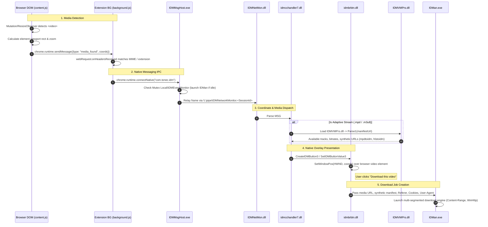

# Comprehensive Architecture Report: Reverse Engineering Internet Download Manager (IDM) Video Detection & Interception System

## 1. Executive Summary

Internet Download Manager (IDM) employs a multi-tiered, hybrid architecture to detect, classify, overlay, and download web video streams. Rather than relying entirely on browser extensions or standalone network packet sniffing, IDM splits its responsibilities across:
1. **In-browser DOM observation and network header inspection** (`content.js` and `background.js` in Chrome/Edge/Firefox extensions),
2. **Standard Native Messaging bridging** (`IDMMsgHost.exe`),
3. **Local IPC via named pipes and loopback sockets** (`IDMNetMon.dll`),
4. **Adaptive streaming manifest parsing** (`IDMVMPrs.dll`),
5. **A native Win32 window overlay engine** (`idmcchandler7.dll` and `idmbrbtn.dll`), and
6. **A multi-segmented HTTP/HTTPS download coordinator** (`IDMan.exe`).

Crucially, reverse engineering revealed that **IDM does not render the "Download this video" panel inside the browser DOM**. Instead, the browser extension continuously relays the bounding screen coordinates of HTML5 media elements across Native Messaging to IDM, which positions a native Win32 floating window directly over the browser's video element using `SetWindowPos`.

---

## 2. Component Role Matrix & Verified Evidence

Based on recursive inventory, PE header parsing, import analysis, and Ghidra decompilation, the actual roles of all relevant IDM components were established:

| Component | Architecture | Size (Bytes) | SHA-256 (Prefix) | Verified Architectural Role |
| :--- | :--- | :--- | :--- | :--- |
| `IDMan.exe` | PE32 (x86) | 6,201,712 | `1016fe2cf065` | Main GUI application, download task coordinator, multi-connection segment engine, and synthetic scheme consumer (`mpdtoidm:///`, `hlstoidm://`). |
| `IDMMsgHost.exe` | PE32 (x86) | 39,168 | `3651bc2150fe` | Native Messaging host executable launched by Chromium and Firefox. Bridges standard I/O (stdin/stdout) to named pipe `\\.\pipe\IDMNetworkMonitor.<SessionId>`. |
| `idmcchandler7.dll` | PE32 (x86) | 405,304 | `0313f8c85854` | Browser integration coordinator. Registers window class `IDM_Download_Panel_controller2_class`, manages overlay panel lifecycle, loads manifest parser `IDMVMPrs.dll`. |
| `idmbrbtn.dll` | PE32 (x86) | 232,304 | `f04f2913e0c0` | Native Win32 button and overlay rendering DLL. Exports `CreateIDMButton3`, `SetIDMButtonValue3`, and `CreateDownlSelWtIDMButton`. Calls `SetWindowPos` to track browser viewport. |
| `IDMNetMon.dll` | PE32 (x86) | 503,152 | `1bb0ecf3f4c6` | Network monitoring and IPC server. Creates `\\.\pipe\IDMNetworkMonitor.<SessionId>` named pipe, opens loopback TCP listener (`ws://127.0.0.1:1001`), parses `MSG#` framing. |
| `IDMVMPrs.dll` | PE32 (x86) | 337,216 | `15f9175aee50` | Video Manifest Parser ("VMPrs"). Dynamically loaded by `idmcchandler7.dll` (`Parse1`) to parse MPEG-DASH (`.mpd`) and HLS (`.m3u8`) playlists. |
| `idmBroker.exe` | PE32 (x86) | 156,984 | `26ff6412e0e4` | Low-integrity COM out-of-process server (`idmBroker.OptionsReader`). Used by sandboxed Internet Explorer / legacy Edge to read configuration options. Zero video detection role. |
| `IDMGCExt` | MV3 CRX | ~104,000 | N/A | Chrome/Edge extension. Observes DOM media nodes via `MutationObserver`/`ResizeObserver`, intercepts network responses via `chrome.webRequest.onHeadersReceived`, communicates via Native Messaging. |

---

## 3. End-to-End Execution Trace



---

## 4. Stage-by-Stage Detailed Architectural Analysis

### Stage 1: Browser DOM Observation (`content.js`)
- **Element Observers**: `content.js` registers observers on DOM elements:
  - `MutationObserver` monitors for dynamically injected `<video>`, `<audio>`, `<embed>`, `<object>`, and `<iframe>` elements.
  - `ResizeObserver` and `IntersectionObserver` track changes in element size, scrolling, and visibility within the active viewport.
- **Viewport Math (`P(a)`)**:
  - `content.js` computes element coordinates:
    $$\text{ScreenX} = \text{window.screenX} + \text{clientRect.left} \times \text{devicePixelRatio}$$
    $$\text{ScreenY} = \text{window.screenY} + (\text{window.outerHeight} - \text{window.innerHeight}) + \text{clientRect.top} \times \text{devicePixelRatio}$$
  - It accounts for page zoom levels, iframe offsets, scroll offsets, and CSS transforms to derive the exact desktop screen bounding rectangle.
  - Periodic polling (heartbeat) ensures that if a user scrolls or resizes the browser window, updated coordinates are transmitted.

### Stage 2: Network Traffic Interception & Classification (`background.js`)
- **`chrome.webRequest.onHeadersReceived`**:
  - `background.js` listens to all HTTP response headers before media content is buffered.
  - Function `Hc(a,b)` verifies responses against a MIME type lookup table (`Aa`):
    - `video/mp4`, `video/webm`, `video/ogg`, `video/quicktime`, `video/x-msvideo`, `video/x-flv`
    - `video/MP2T`, `application/x-mpegURL`, `application/vnd.apple.mpegurl`
    - `application/dash+xml`, `application/f4m`, `video/f4m`
    - `audio/mp4`, `audio/mpeg`, `audio/webm`, `audio/aac`, `audio/flac`, `audio/ogg`
  - Responses with matching `Content-Disposition` headers containing `.mp4`, `.mkv`, `.avi`, `.webm`, or matching URL path patterns are flagged.
  - Size filtering: Content lengths below configurable thresholds (e.g., small video previews or audio sprites $< 100 \text{ KB}$) are excluded from triggering the panel.

### Stage 3: IPC & Native Messaging Protocol
- **Browser Native Messaging Host**:
  - The browser launches `IDMMsgHost.exe` based on the manifest registered at `HKCU\Software\Google\Chrome\NativeMessagingHosts\com.tonec.idm`.
  - Manifest specifies:
    ```json
    {
      "name": "com.tonec.idm",
      "description": "Internet Download Manager Native Messaging Host",
      "path": "IDMMsgHost.exe",
      "type": "stdio",
      "allowed_origins": [
        "chrome-extension://ngpampappnmepgilojfohadhhmbhlaek/",
        "chrome-extension://llbjbkhnmlidjebalopleeepgdfgcpec/"
      ]
    }
    ```
- **Mutex & Auto-launch Logic in `IDMMsgHost.exe`**:
  - Decompiled function `FUN_00402830` in `IDMMsgHost.exe`:
    - Checks for mutex `Local\IDMEventMonitor`.
    - If IDM is not running, it reads `HKLM\Software\Internet Download Manager\InstallStatus`, resolves `IDMan.exe`, and starts it with `CoCreateInstance` / `CreateProcess`.
    - Retrieves active desktop session ID via `ProcessIdToSessionId(GetCurrentProcessId(), &dwSessionId)`.
    - Opens named pipe: `\\.\pipe\IDMNetworkMonitor.<SessionId>`.
- **Protocol Message Framing**:
  - Messages across the named pipe (and fallback loopback WebSocket `ws://127.0.0.1:1001`) use ASCII framing:
    `MSG#<seq_num>#<message_type>#<sub_type>#<flags>:<length>:<payload_data>;`
  - **Type 9 / Type 10**: Coordinate and viewport updates (passing `hwnd`, `left`, `top`, `right`, `bottom`, `visible`, `tabId`).
  - **Type 13 / Type 14**: Media candidate metadata (passing `url`, `referer`, `cookies`, `user_agent`, `content_type`, `file_size`).

### Stage 4: "Download this video" Button Display Logic
- **Native Window Overlay vs DOM Injection**:
  - Crucial Discovery: IDM does **not** inject HTML/CSS into the web page to draw the download button. This avoids web page CSS clashes, shadow DOM isolation, and iframe sandbox restrictions.
  - `idmcchandler7.dll` registers a native Win32 window class: `IDM_Download_Panel_controller2_class`.
  - It dynamically loads `idmbrbtn.dll` and calls exported functions:
    - `CreateIDMButton3`: Instantiates the native button control window.
    - `SetIDMButtonValue3`: Updates button text, state, and menu items (e.g., list of available resolutions).
  - Decompiled function `FUN_10003c30` in `idmbrbtn.dll`:
    - Evaluates coordinates received from the browser extension.
    - Executes `SetWindowPos(hWndButton, HWND_TOPMOST, x, y, width, height, SWP_SHOWWINDOW | SWP_NOACTIVATE)`.
    - When the media element scrolls out of view or the tab is switched, it invokes `SetWindowPos(..., SWP_HIDEWINDOW)`.
  - When hovered or clicked, `idmbrbtn.dll` renders a Win32 pop-up menu (`TrackPopupMenuEx`) displaying available video resolutions, bitrates, and audio tracks.

### Stage 5: Adaptive Stream Manifest Parsing (HLS & MPEG-DASH)
- **Manifest Interception**:
  - When `background.js` or `idmcchandler7.dll` detects an `.m3u8` (HLS) or `.mpd` (DASH) URL:
  - `idmcchandler7.dll` dynamically loads `IDMVMPrs.dll` ("Video Manifest Parser") and invokes its exported parsing routine (`Parse1`).
- **Synthetic URL Scheme Generation**:
  - `IDMVMPrs.dll` and `IDMNetMon.dll` parse the XML/playlist structure to extract individual audio/video adaptation sets and segment templates.
  - To hand off the multi-segment stream to IDM's single-task download coordinator, IDM generates internal synthetic URI schemes:
    - `mpdtoidm:///`: Represents an MPEG-DASH video track.
    - `mpdatoidm:///`: Represents an MPEG-DASH paired audio track.
    - `hlstoidm://` / `hls2toidm://`: Represents an HLS live/VOD stream.
    - `ytatoidm://` / `yta2toidm://` / `yta3toidm://`: Represents specialized video-audio paired streams.
  - These synthetic schemes encapsulate the original manifest URL, segment base URLs, and initialization segment ranges.

### Stage 6: Passing Media to IDM Download Engine
- **Task Dispatch**:
  - Once the user clicks a resolution in the floating button menu:
  - `idmbrbtn.dll` / `idmcchandler7.dll` sends an IPC command to `IDMan.exe`.
  - The command contains:
    1. Media URL (or synthetic manifest URL).
    2. HTTP `Referer` header captured from the active browser tab.
    3. Browser `Cookie` jar relevant to the media request.
    4. Browser `User-Agent` string (ensuring CDN token validation matches the browser).
- **Download Coordinator Execution**:
  - `IDMan.exe` displays the "Download File Info" dialog or immediately begins fetching.
  - For standard media (`video/mp4`, `video/webm`): `IDMan.exe` uses `WinHttpOpen` / `WinInet` socket requests with `Range: bytes=X-Y` to establish multiple concurrent segmented connections.
  - For adaptive streams (`mpdtoidm:///`, `hlstoidm://`): `IDMan.exe` parses the synthetic URL parameters, downloads the individual media chunks (`.ts` or `.m4s` segments) sequentially/concurrently, and stitches or multiplexes the video and audio streams into a clean local container file (e.g. `.mp4`).

---

## 5. Evidence & Ghidra Decompilation Cross-References

| Address | Binary | Function Symbol | Evidence & Role |
| :--- | :--- | :--- | :--- |
| `0x00402830` | `IDMMsgHost.exe` | `FUN_00402830` | Checks mutex `Local\IDMEventMonitor`, resolves session ID, and connects to named pipe `\\.\pipe\IDMNetworkMonitor.<SessionId>`. |
| `0x10003c30` | `idmbrbtn.dll` | `FUN_10003c30` | Calls Win32 `SetWindowPos` (`0x40` show, `0x80` hide) to position the native "Download this video" button over browser coordinates. |
| `0x10016f10` | `idmcchandler7.dll` | `FUN_10016f10` | MIME sniffer routine checking `video/mp4`, `video/webm`, `video/MP2T`, `application/dash+xml`, `application/vnd.apple.mpegurl`. |
| `0x100230a0` | `idmcchandler7.dll` | `FUN_100230a0` | Manifest loader resolving `mpdatoidm`, `mpdtoidm`, and dynamically loading `IDMVMPrs.dll` (`Parse1`). |
| `0x1000e990` | `idmcchandler7.dll` | `FUN_1000e990` | Window procedure and controller for `IDM_Download_Panel_controller2_class`. |
| `0x10013d30` | `IDMNetMon.dll` | `FUN_10013d30` | Named pipe server initialisation (`\\.\pipe\IDMNetworkMonitor.%u`) and fallback TCP socket (`ws://127.0.0.1:1001`). |
| `0x10034b40` | `IDMNetMon.dll` | `FUN_10034b40` | Parser and dispatcher for ASCII protocol framing `MSG#<seq>#<type>#...`. |
| `0x1003ced0` | `IDMNetMon.dll` | `FUN_1003ced0` | URL scheme classifier identifying `http:`, `https:`, `hlstoidm:`, `hls2toidm:`, `dhstoidm:`, `ytatoidm:`. |
| `0x10019660` | `IDMNetMon.dll` | `FUN_10019660` | Browser client classifier checking process names `chrome.exe`, `firefox.exe` and RTTI classes `PluginClient` / `BasicClient`. |
| `0x00426f10` | `IDMan.exe` | `FUN_00426f10` | Main media stream ingestion and synthetic URL dispatcher (`mpdtoidm:///`, `mpdatoidm:///`, `hlstoidm://`, `hls2toidm://`). Loads `idmbrbtn.dll` interface. |
| `0x0042a180` | `IDMan.exe` | `FUN_0042a180` | Adaptive stream metadata unpacker; extracts manifest parameters, audio/video track pairs, and base segment paths. |
| `0x00430560` | `IDMan.exe` | `FUN_00430560` | MIME type verification routine for direct media downloads (`video/mp4`, `video/webm`). |
| `0x00592d50` | `IDMan.exe` | `FUN_00592d50` | HLS transport stream (`video/MP2T`, `application/vnd.apple.mpegurl`) handler; parses stream tags and sets HTTP `Referer`. |
| `0x0058c7f0` | `IDMan.exe` | `FUN_0058c7f0` | HTTP chunk / multi-connection engine; parses `Content-Range` headers and calculates segment byte offsets. |
| `0x004b8980` | `IDMan.exe` | `FUN_004b8980` | HTTP client subsystem initialization calling `WinHttpOpen` with IDM user-agent and connection pool. |
| `0x00610980` | `IDMan.exe` | `FUN_00610980` | Desktop named pipe connection interface (`\\.\pipe\`) communicating with `IDMNetMon.dll` and `IDMMsgHost.exe`. |
| `0x0060e7b0` | `IDMan.exe` | `FUN_0060e7b0` | `MSG#` protocol frame encoder/decoder for inter-module synchronization. |
| `0x00412e50` | `IDMan.exe` | `FUN_00412e50` | Browser integration installer/verifier checking `com.tonec.idm` registry entries and `IDMMsgHost.exe` binary presence. |

---

## 6. Categorization of Findings

### 6.1 Confirmed Facts
1. **Overlay Mechanism**: The "Download this video" button is 100% a native Win32 window (`HWND`), NOT DOM-injected HTML. It is created by `idmcchandler7.dll` / `idmbrbtn.dll` and positioned via `SetWindowPos` using screen coordinates calculated by `content.js`.
2. **Native Messaging Host**: The browser communicates strictly with `IDMMsgHost.exe` via stdin/stdout length-prefixed JSON.
3. **Desktop IPC**: `IDMMsgHost.exe` bridges the browser connection to `IDMNetMon.dll` via the named pipe `\\.\pipe\IDMNetworkMonitor.<SessionId>`.
4. **Adaptive Stream Schemes**: IDM uses custom synthetic protocols (`mpdtoidm:///`, `mpdatoidm:///`, `hlstoidm://`, `ytatoidm://`) to represent multi-track adaptive streams.
5. **Manifest Parsing Module**: Adaptive streams are parsed by `IDMVMPrs.dll` ("Video Manifest Parser"), loaded on demand.
6. **Broker Isolation**: `idmBroker.exe` is purely an options/settings reader COM server for low-integrity sandboxes; it has zero involvement in video detection or network monitoring.

### 6.2 Hypotheses
1. **Fallback WebSocket IPC**: When Native Messaging fails or is disabled by group policy, the extension attempts connection to `ws://127.0.0.1:1001`, which is opened by `IDMNetMon.dll`'s `WSAStartup`/`socket` routines.
2. **Dynamic Segment Stitching**: IDM downloads individual audio and video `.m4s` segments into temporary files (`idmtmp`), then performs container multiplexing (remuxing) to produce the final `.mp4` file without re-encoding video frames.

### 6.3 Open Questions & Future Investigation
1. **Encrypted Media Extensions (EME / DRM)**: Does IDM attempt detection of EME initialization segments, or does it silently decline to offer download buttons when `cenc` / Widevine PSSH boxes are encountered in `.mpd` manifests?
2. **Cookie Jar Synchronization**: Exactly how does IDM capture HTTP-only or SameSite-strict cookies when requests originate from cross-origin iframes embedded on a page?
